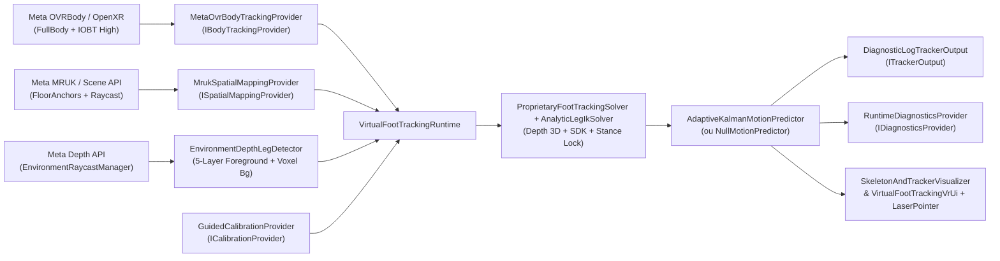

# 02 — Arquitetura de Software e Decisões Técnicas (ADRs)

## 1. Visão Geral Modular

A arquitetura separa completamente os contratos biomecânicos e de tracking (`VirtualFootTracking.Core`, sem dependência de APIs proprietárias da Meta) das implementações concretas ligadas ao Quest 3S (`OVRBody`, `OVRPlugin`, `MRUK`), permitindo substituir o provedor de rastreamento, o solver IK, o preditor de movimento ou o transporte de rede sem reconstruir a aplicação.

---

## 2. Contratos Principais (`Assets/Scripts/Core/Interfaces/`)

| Interface | Responsabilidade | Implementação Atual (Fase 2) |
| :--- | :--- | :--- |
| `IBodyTrackingProvider` | Gerenciar permissão `BODY_TRACKING`, configurar `FullBody` + `High` IOBT e fornecer `BodySkeletonSnapshot`. | `MetaOvrBodyTrackingProvider` |
| `ISpatialMappingProvider` | Gerenciar permissão `USE_SCENE`, carregar sala do dispositivo via `MRUK`, expor polígono/altura do piso (`FloorPlaneData`) e raycast vertical no piso. | `MrukSpatialMappingProvider` |
| `IFootTrackingSolver` | Transformar o esqueleto + plano do piso + calibração nos quatro trackers virtuais (`VirtualTrackerFrame`). | `ProprietaryFootTrackingSolver` (com alternância A/B para `DiagnosticPassthroughFootSolver`) |
| `ICalibrationProvider` | Captura guiada multi-frame em pé (`2,5s`), ajustes manuais granulares e persistência JSON (`CalibrationProfile`). | `GuidedCalibrationProvider` |
| `ITrackerOutput` | Consumir quadros resolvidos (buffer de diagnóstico local; pronto para UDP/USB na Fase 3). | `DiagnosticLogTrackerOutput` |
| `IDiagnosticsProvider` | Medir FPS, frequência real de atualização de body tracking (Hz), latência do solver+Kalman (ms), modo ativo e erros. | `RuntimeDiagnosticsProvider` |

---

## 3. Modelo de Dados dos Trackers (`VirtualTrackerTypes.cs`)

Cada um dos quatro trackers (`LeftFoot`, `RightFoot`, `LeftKnee`, `RightKnee`) é emitido como um `VirtualTrackerSample` contendo:

- `Id`: `VirtualTrackerId` (`LeftFoot`, `RightFoot`, `LeftKnee`, `RightKnee`)
- `Position` (`Vector3`) e `Rotation` (`Quaternion`)
- `LinearVelocity` (`Vector3`) e `AngularVelocity` (`Vector3`)
- `TimestampSeconds` (`double`, monotonic `realtimeSinceStartupAsDouble`)
- `Validity`: `Invalid`, `Valid`, `Degraded`, `TemporarilyLost`
- `Source`: `Unavailable`, `SdkObserved`, `SdkEstimatedGenerativeLegs`, `EngineBiomechanicalFallback`, `EngineMotionPredicted`, `DepthObserved` (`DEPTH_3D`)
- `Confidence`: `0.0f` a `1.0f`
- `Space`: `UnityWorldSpace`, `TrackingRigLocalSpace` ou `HeadsetLocalSpace`
- `HeightAboveFloorMeters` (`float`), `IsGrounded` (`bool`), `FloorClamped` (`bool`)

---

## 4. Pipeline Explícito de Coordenadas

Para nunca misturar espaços de coordenadas sem transformação explícita:

1. **Espaço nativo OVR/OpenXR (mão direita):** `OVRPlugin.GetBodyState4` entrega `Posef.Position` e `Posef.Orientation` relativos ao Tracking Space com eixo Z invertido em relação à Unity.
2. **Espaço Tracking Rig da Unity (mão esquerda):** `MetaOvrBodyTrackingProvider` converte explicitamente com `OVRExtensions.FromFlippedZVector3f(...)` e `OVRExtensions.FromFlippedZQuatf(...)` -> armazenado em `BodyJointSample.TrackingSpacePosition/Rotation`.
3. **Espaço Global da Unity (`UnityWorldSpace`):** transformado por `OVRCameraRig.trackingSpace.TransformPoint(...)` e `trackingSpace.rotation * tsRot` -> armazenado em `BodyJointSample.WorldPosition/Rotation` e `VirtualTrackerSample` (`Space = CoordinateSpace.UnityWorldSpace`).
4. **Alinhamento com o Chão:** `OVRCameraRig` utiliza `OVRManager.TrackingOrigin.Stage`, e `MrukSpatialMappingProvider` lê `MRUKRoom.FloorAnchors` em coordenadas de mundo Unity (`anchor.transform.position.y` e `anchor.transform.TransformPoint(pt.x, pt.y, 0)`).

---

## 5. Decisões Arquiteturais (ADRs)

### ADR-001 — Classificação Honesta de Proveniência no Quest 3S
- O Meta Quest 3S possui câmeras voltadas para frente/lados/baixo para rastreio de mãos, torso e ambiente (IOBT — `BodyTrackingFidelity2.High`), **mas não vê diretamente os pés e tornozelos**.
- No `OVRPlugin.BoneId`, as juntas `70..83` (`FullBody_LeftUpperLeg` até `FullBody_RightFootBall`) são fornecidas pelo modelo **Generative Legs** da Meta.
- Portanto, `MetaOvrBodyTrackingProvider` classifica todas as juntas `70..83` como `TrackingDataSource.SdkEstimatedGenerativeLegs` (cor **Ciano** na cena diagnóstica), diferenciando-as das juntas superiores com `SpaceLocationFlags.PositionTracked` (`SdkObserved`, cor **Verde**).

### ADR-002 — Built-in Render Pipeline (BiRP) + Passthrough Underlay na Fase 1
- Utilizar BiRP + `UnityEngine.UI.Text` (`LegacyRuntime.ttf`) + `OVRPassthroughLayer` (`Underlay`) garante criação e compilação headless sem exigir importação manual de assets TMP/URP e permite ao usuário enxergar o **chão físico real** sob os trackers virtuais durante testes de chute e caminhada em Quest 3S.

### ADR-003 — Foot Tracking Engine Próprio + Modo A/B Diagnóstico (`v0.2.0`)
- `ProprietaryFootTrackingSolver` combina detecção de piso MRUK (`TryQueryFloorHeightAt`), histerese de contato (*Stance* vs *Swing* com *Foot Locking* elástico de `0,09m` para liberar chutes rápidos instantaneamente), `AnalyticLegIkSolver` (limites anatômicos `2°–148°` com polo anterior anti-hiperextensão) e `EngineBiomechanicalFallback` quando juntas inferiores estiverem inválidas.
- `AdaptiveKalmanMotionPredictor` escala o ruído de processo $Q$ dinamicamente entre repouso (`0,25`) e movimentos explosivos de combate (`320,0`), extrapolando perdas momentâneas por até `0,35s` com marcação explícita `EngineMotionPredicted` (Magenta).
- O usuário pode alternar em tempo real entre o Motor Próprio e o `DiagnosticPassthroughFootSolver` (botão `Y` ou UI Live Tracking) para comparação A/B direta no headset.

### ADR-004 — Blueprint de Comunicação PC / SteamVR (`TrackerPacketSchema.cs`)
- O schema `TrackerPacketFrame` (`Magic = "VFT1"`, versão `1`, `SequenceNumber`, `MonotonicTimestampNs`, `FloorHeightWorldY` e `4 × TrackerWireEntry`) já prepara o payload que será transmitido via UDP Wi-Fi (ou USB ADB forward) para o futuro driver C++ `openvr` (`vr::ITrackedDeviceServerDriver` registrado como `vr::TrackedDeviceClass_GenericTracker`) na Fase 4.

### ADR-009 — Detecção Física de Pernas e Chutes via Depth API em Tempo Real (`v0.3.0` / `v0.3.1`)
- Testes em hardware real mostraram que o `Generative Legs` da Meta (`v0.2.0`) estima bem passos e apoio no piso (~90% segundo o usuário), mas **não detecta chutes isolados no ar nem elevação estacionária de joelho**, pois não há câmeras dedicadas aos pés e o modelo reage apenas ao movimento do tronco/cabeça.
- Embora o Scene Mapping estático (Space Setup / âncoras de móveis) seja atualizado apenas por escaneamento manual e não sirva para membros dinâmicos, a **Depth API em tempo real** (`Meta.XR.EnvironmentRaycastManager` sobre OpenXR no Quest 3S) atualiza o mapa de profundidade a cada frame dentro do cone frontal das câmeras (`~±34°` H × `-52°..+2°` V na grade `13×10`, até `2,8 m`).
- `EnvironmentDepthLegDetector` isola apenas a perna em movimento aplicando filtragem multi-camada por frame:
  1. **Base Corporal Bilateral (`v0.3.1`):** calcula `pelvisRightFlat` diretamente de `RightUpperLeg - LeftUpperLeg` (fallback para braços/ombros superiores ou `headTransform.right`) e `pelvisForwardFlat = Cross(pelvisRightFlat, Up)` — evitando a rotação local de osso de `OVRBody` (`hips.WorldRotation * Vector3.forward`), que apontava lateralmente.
  2. **Piso:** descarta pontos com `y <= floorY + 0,10 m`.
  3. **Aprendizado Automático + Ambiente Estático (`v0.3.1`):** pontos fora do alcance anatômico alimentam continuamente `_autoStaticVoxels` (voxels `0,11 m`, máx. `4096`), somados aos volumes/superfícies `MRUKRoom` (`IsPositionInRoom`, `IsPositionInSceneVolume`, `TryGetClosestSurfacePosition <= 0,14 m`) e à rejeição de planos verticais de parede.
  4. **Tronco & Braços:** exclui pontos acima de `pelvisY + 0,14 m` e cápsulas/esferas de `OVRBody` (braços, punhos, mãos) + `leftHandAnchor/rightHandAnchor`.
  5. **Cluster Sagital & Extremidade Real (`v0.3.1`):** filtra por plano sagital da perna (`±0,22 m` da mediana lateral) e pega a extremidade distal suportada real (sem puxar para o centroide da coxa), mantendo o joelho esticado em chutes retos e flexionado em elevação de joelho (`IsKneeDominant`).
- Quando um cluster válido (`>= 3` inliers) indica pé elevado, passo/chute ou joelho erguido, `ProprietaryFootTrackingSolver` destrava o pé do piso imediatamente, guia a IK 2-bone e classifica explicitamente os trackers com `TrackingDataSource.DepthObserved` (`DEPTH_3D`, cor **Amarela**). Fora do frustum frontal, retorna suavemente para `SdkEstimatedGenerativeLegs` + trava de piso.
