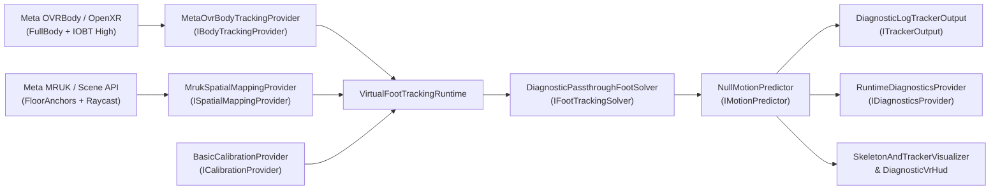

# 02 — Arquitetura de Software e Decisões Técnicas (ADRs)

## 1. Visão Geral Modular

A arquitetura separa completamente os contratos biomecânicos e de tracking (`VirtualFootTracking.Core`, sem dependência de APIs proprietárias da Meta) das implementações concretas ligadas ao Quest 3S (`OVRBody`, `OVRPlugin`, `MRUK`), permitindo substituir o provedor de rastreamento, o solver IK, o preditor de movimento ou o transporte de rede sem reconstruir a aplicação.

---

## 2. Contratos Principais (`Assets/Scripts/Core/Interfaces/`)

| Interface | Responsabilidade | Implementação Fase 1 |
| :--- | :--- | :--- |
| `IBodyTrackingProvider` | Gerenciar permissão `BODY_TRACKING`, configurar `FullBody` + `High` IOBT e fornecer `BodySkeletonSnapshot`. | `MetaOvrBodyTrackingProvider` |
| `ISpatialMappingProvider` | Gerenciar permissão `USE_SCENE`, carregar sala do dispositivo via `MRUK`, expor polígono/altura do piso (`FloorPlaneData`) e raycast vertical no piso. | `MrukSpatialMappingProvider` |
| `IFootTrackingSolver` | Transformar o esqueleto + plano do piso + calibração nos quatro trackers virtuais (`VirtualTrackerFrame`). | `DiagnosticPassthroughFootSolver` |
| `ICalibrationProvider` | Estimar medidas antropométricas automáticas a partir da altura HMD/chão e persistir `CalibrationProfile` em JSON. | `BasicCalibrationProvider` |
| `ITrackerOutput` | Consumir quadros resolvidos (buffer de diagnóstico na Fase 1; transporte UDP/USB na Fase 2). | `DiagnosticLogTrackerOutput` |
| `IDiagnosticsProvider` | Medir FPS, frequência real de atualização de body tracking (Hz), latência do solver (ms), perdas e erros recentes. | `RuntimeDiagnosticsProvider` |

---

## 3. Modelo de Dados dos Trackers (`VirtualTrackerTypes.cs`)

Cada um dos quatro trackers (`LeftFoot`, `RightFoot`, `LeftKnee`, `RightKnee`) é emitido como um `VirtualTrackerSample` contendo:

- `Id`: `VirtualTrackerId` (`LeftFoot`, `RightFoot`, `LeftKnee`, `RightKnee`)
- `Position` (`Vector3`) e `Rotation` (`Quaternion`)
- `LinearVelocity` (`Vector3`) e `AngularVelocity` (`Vector3`)
- `TimestampSeconds` (`double`, monotonic `realtimeSinceStartupAsDouble`)
- `Validity`: `Invalid`, `Valid`, `Degraded`, `TemporarilyLost`
- `Source`: `Unavailable`, `SdkObserved`, `SdkEstimatedGenerativeLegs`, `EngineBiomechanicalFallback`, `EngineMotionPredicted`
- `Confidence`: `0.0f` a `1.0f`
- `Space`: `UnityWorldSpace`, `TrackingRigLocalSpace` ou `HeadsetLocalSpace`
- `HeightAboveFloorMeters` (`float`), `IsGrounded` (`bool`), `FloorClamped` (`bool`)

---

## 4. Pipeline Explícito de Coordenadas

Para nunca misturar espaços de coordenadas sem transformação explícita:

1. **Espaço nativo OVR/OpenXR (mão direita):** `OVRPlugin.GetBodyState4` entrega `Posef.Position` e `Posef.Orientation` relativos ao Tracking Space com eixo Z invertido em relação à Unity.
2. **Espaço Tracking Rig da Unity (mão esquerda):** `MetaOvrBodyTrackingProvider` converte explicitamente com `OVRExtensions.FromFlippedZVector3f(...)` e `OVRExtensions.FromFlippedZQuatf(...)` -> armazenado em `BodyJointSample.TrackingSpacePosition/Rotation`.
3. **Espaço Global da Unity (`UnityWorldSpace`):** transformado por `OVRCameraRig.trackingSpace.TransformPoint(...)` e `trackingSpace.rotation * tsRot` -> armazenado em `BodyJointSample.WorldPosition/Rotation` e `VirtualTrackerSample` (`Space = CoordinateSpace.UnityWorldSpace`).
4. **Alinhamento com o Chão:** `OVRCameraRig` utiliza `OVRManager.TrackingOrigin.Stage`, e `MrukSpatialMappingProvider` lê `MRUKRoom.FloorAnchors` em coordenadas de mundo Unity (`anchor.transform.position.y` e `anchor.transform.TransformPoint(pt.x, pt.y, 0)`).

---

## 5. Decisões Arquiteturais (ADRs)

### ADR-001 — Classificação Honesta de Proveniência no Quest 3S
- O Meta Quest 3S possui câmeras voltadas para frente/lados/baixo para rastreio de mãos, torso e ambiente (IOBT — `BodyTrackingFidelity2.High`), **mas não vê diretamente os pés e tornozelos**.
- No `OVRPlugin.BoneId`, as juntas `70..83` (`FullBody_LeftUpperLeg` até `FullBody_RightFootBall`) são fornecidas pelo modelo **Generative Legs** da Meta.
- Portanto, `MetaOvrBodyTrackingProvider` classifica todas as juntas `70..83` como `TrackingDataSource.SdkEstimatedGenerativeLegs` (cor **Ciano** na cena diagnóstica), diferenciando-as das juntas superiores com `SpaceLocationFlags.PositionTracked` (`SdkObserved`, cor **Verde**).

### ADR-002 — Built-in Render Pipeline (BiRP) + Passthrough Underlay na Fase 1
- Utilizar BiRP + `UnityEngine.UI.Text` (`LegacyRuntime.ttf`) + `OVRPassthroughLayer` (`Underlay`) garante criação e compilação headless sem exigir importação manual de assets TMP/URP e permite ao usuário enxergar o **chão físico real** sob os trackers virtuais durante testes de chute e caminhada em Quest 3S.

### ADR-003 — Modo Diagnóstico Cru Antes do Solver Biomecânico Avançado
- O `DiagnosticPassthroughFootSolver` inicia com `_enableFloorPenetrationClamp = false` (alternável pelo botão `Y`) e `NullMotionPredictor`, expondo sem maquiagem qualquer penetração no piso ou atraso das estimativas de pernas da Meta antes da implementação do solver IK + Kalman da Fase 2.

### ADR-004 — Blueprint de Comunicação PC / SteamVR (`TrackerPacketSchema.cs`)
- O schema `TrackerPacketFrame` (`Magic = "VFT1"`, versão `1`, `SequenceNumber`, `MonotonicTimestampNs`, `FloorHeightWorldY` e `4 × TrackerWireEntry`) já prepara o payload que será transmitido via UDP Wi-Fi (ou USB ADB forward) para o futuro driver C++ `openvr` (`vr::ITrackedDeviceServerDriver` registrado como `vr::TrackedDeviceClass_GenericTracker`) na Fase 2/3.
